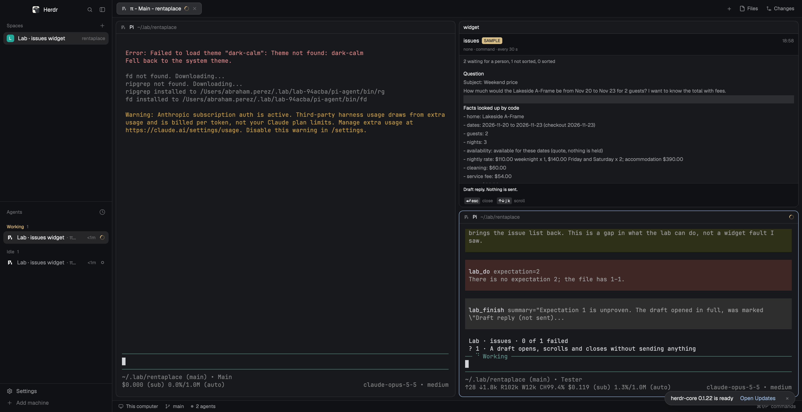

# issues · lab report

**1 unproven (the lab could not see enough to judge)** · 11/22/2026, 6:59:05 PM · run `lab-94acba`

Expectation 1 is unproven. The draft opened in full, was marked "Draft reply (not sent)" and scrolled with down, and nothing was sent to Main and no file changed. The final Esc step could not be sent because lab_widget only accepts letter, digit, up, down and enter, so I could not see whether the issue list comes back.

Widget: `issues` on its saved sample · Widget model: `none` · Guest Main model: `anthropic/claude-opus-5-5` · Tester model: `anthropic/claude-opus-5-5`
Expectations: `widgets/issues/expectations.md`

## ? 1 · A draft opens, scrolls and closes without sending anything

Steps 1–3 worked: Enter opened the whole draft with Question, Facts looked up by code and Draft reply (not sent), the panel said "Draft reply. Nothing is sent.", and three downs moved the ▶ down inside the draft. Nothing was sent to Main and no file changed. Step 4 ("press Esc") could not run because lab_widget rejects Esc ("Not a key the panel reads: esc") and the panel has no close button, so the draft is still open. I could not see whether Esc brings the issue list back. This is a gap in what the lab can do, not a widget fault I saw.

- issues: “Facts looked up by code”
- issues: “Draft reply (not sent)”
- issues: “Draft reply. Nothing is sent.”
- issues: “[⏎ esc] close  [↑↓ j k] scroll”
- Files: “No project file changed.”

## What each pane showed

### Main

~~~text

 Error: Failed to load theme "dark-calm": Theme not found: dark-calm
 Fell back to the system theme.

 fd not found. Downloading...
 ripgrep not found. Downloading...
 ripgrep installed to /Users/abraham.perez/.lab/lab-94acba/pi-agent/bin/rg
 fd installed to /Users/abraham.perez/.lab/lab-94acba/pi-agent/bin/fd

 Warning: Anthropic subscription auth is active. Third-party harness usage draws from extra
 usage and is billed per token, not your Claude plan limits. Manage extra usage at
 https://claude.ai/settings/usage. Disable this warning in /settings.

────────────────────────────────────────────────────────────────────────────────────────────

────────────────────────────────────────────────────────────────────────────────────────────
~/.lab/rentaplace (main) • Main
$0.000 (sub) 0.0%/1.0M (auto)                                       claude-opus-5-5 • medium
~~~

### issues

~~~text
--- 00:58:08 ---
issues · SAMPLE
none · command · every 30 s
No result yet. Press r to refresh.

[esc] back to Main  [↑↓ j k] select  [r] refresh from sample
--- 00:58:08 ---
issues · SAMPLE · 18:58
none · command · every 30 s
2 waiting for a person, 1 not sorted, 0 sorted
▶ 1. [warn] pricing · Weekend price · draft — a0a084b1-56ba-4810-bc8f-701c4a97504f · money · money: moneyP 0.82 >= 0.3 · owner pricing at confidence 0.98
      Question
      Subject: Weekend price
      How much would the Lakeside A-Frame be from Nov 20 to Nov 23 for 2 guests? I want to know the total with fees.
      
      Facts looked up by code
      - home: Lakeside A-Frame
      - dates: 2026-11-20 to 2026-11-23 (checkout 2026-11-23)
      - guests: 2
      - nights: 3
      - availability: available for these dates (quote, nothing is held)
      - nightly rate: $110.00 weeknight x 1, $140.00 Friday and Saturday x 2; accommodation $390.00
      - cleaning: $60.00
      - service fee: $54.00
      - taxes: $36.00
      - total: $540.00
      
      Draft reply (not sent)
      Hi there,
      
      The Lakeside A-Frame is available for 2 guests from November 20 to November 23, 2026 (3 nights, checkout November 23). Here is the breakdown:
      
      - Nightly rate: $110.00 for the weeknight, plus $140.00 for each of Friday and Saturday, for accommodation of $390.00
      - Cleaning fee: $60.00
      - Service fee: $54.00
      - Taxes: $36.00
      - Total: $540.00
      
      These dates are open, but nothing is held or reserved yet. If you'd like to book, just let us know and we can get a reservation started for you. Placing a hold never charges you.
      
      Best,
      RentAPlace Booking
  2. [warn] booking · need some help, urgent — d8f36226-afbc-45a8-942a-d05ffb4411cf · money, unsure · money: moneyP 0.87 >= 0.3 · owner booking at confidence 0.28 · unsure: owner confidence 0.28 < 0.7
  3. [info] not sorted · Pet policy question — ticket-0028

[⏎] open draft  [esc] back to Main  [↑↓ j k] select  [r] refresh from sample
--- 00:58:17 · the Tester clicked item 1 ---
--- 00:58:25 · the Tester pressed enter ---
--- 00:58:26 ---
issues · SAMPLE · 18:58
none · command · every 30 s
2 waiting for a person, 1 not sorted, 0 sorted
▶ Question
  Subject: Weekend price
  How much would the Lakeside A-Frame be from Nov 20 to Nov 23 for 2 guests? I want to know the total with fees.
  
  Facts looked up by code
  - home: Lakeside A-Frame
  - dates: 2026-11-20 to 2026-11-23 (checkout 2026-11-23)
  - guests: 2
  - nights: 3
  - availability: available for these dates (quote, nothing is held)
  - nightly rate: $110.00 weeknight x 1, $140.00 Friday and Saturday x 2; accommodation $390.00
  - cleaning: $60.00
  - service fee: $54.00
  - taxes: $36.00
  - total: $540.00
  
  Draft reply (not sent)
  Hi there,
  
  The Lakeside A-Frame is available for 2 guests from November 20 to November 23, 2026 (3 nights, checkout November 23). Here is the breakdown:
  
  - Nightly rate: $110.00 for the weeknight, plus $140.00 for each of Friday and Saturday, for accommodation of $390.00
  - Cleaning fee: $60.00
  - Service fee: $54.00
  - Taxes: $36.00
  - Total: $540.00
  
  These dates are open, but nothing is held or reserved yet. If you'd like to book, just let us know and we can get a reservation started for you. Placing a hold never charges you.
  
  Best,
  RentAPlace Booking
Draft reply. Nothing is sent.

[⏎ esc] close  [↑↓ j k] scroll
--- 00:58:34 · the Tester pressed down down down ---
--- 00:58:36 ---
issues · SAMPLE · 18:58
none · command · every 30 s
2 waiting for a person, 1 not sorted, 0 sorted
  Question
  Subject: Weekend price
  How much would the Lakeside A-Frame be from Nov 20 to Nov 23 for 2 guests? I want to know the total with fees.
▶ 
  Facts looked up by code
  - home: Lakeside A-Frame
  - dates: 2026-11-20 to 2026-11-23 (checkout 2026-11-23)
  - guests: 2
  - nights: 3
  - availability: available for these dates (quote, nothing is held)
  - nightly rate: $110.00 weeknight x 1, $140.00 Friday and Saturday x 2; accommodation $390.00
  - cleaning: $60.00
  - service fee: $54.00
  - taxes: $36.00
  - total: $540.00
  
  Draft reply (not sent)
  Hi there,
  
  The Lakeside A-Frame is available for 2 guests from November 20 to November 23, 2026 (3 nights, checkout November 23). Here is the breakdown:
  
  - Nightly rate: $110.00 for the weeknight, plus $140.00 for each of Friday and Saturday, for accommodation of $390.00
  - Cleaning fee: $60.00
  - Service fee: $54.00
  - Taxes: $36.00
  - Total: $540.00
  
  These dates are open, but nothing is held or reserved yet. If you'd like to book, just let us know and we can get a reservation started for you. Placing a hold never charges you.
  
  Best,
  RentAPlace Booking
Draft reply. Nothing is sent.

[⏎ esc] close  [↑↓ j k] scroll
~~~

### Files

~~~text
No project file changed.
~~~
